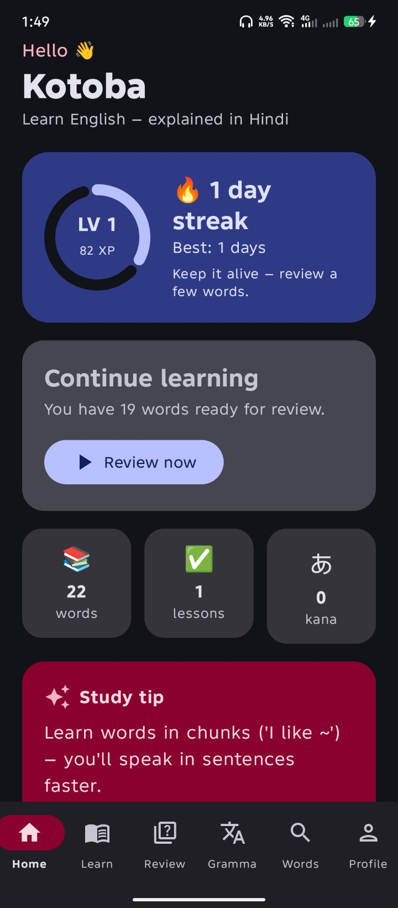
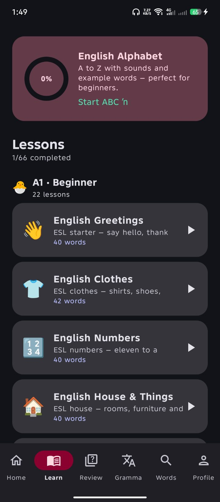
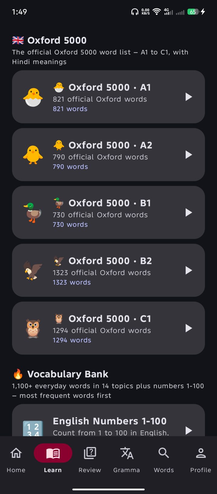
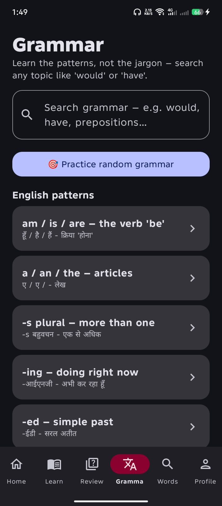
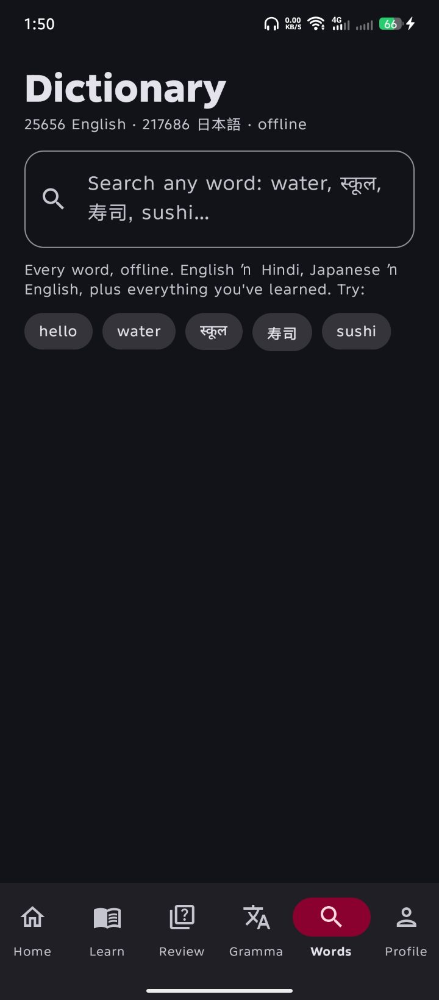
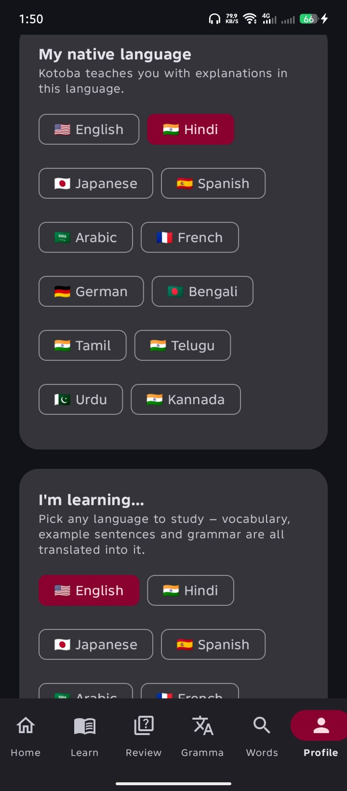
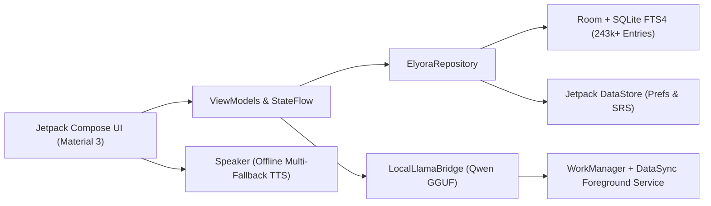

<div align="center">


# Elyora — Learn Every Language

**ভাষা শিখুন, বিশ্বকে জানুন · *Learn every language — explained in yours.***

[](https://github.com/mohammad-sheikh-shahinur-rahman/Elyora-Learn-Every-Language/releases/latest)
[](https://github.com/mohammad-sheikh-shahinur-rahman/Elyora-Learn-Every-Language/actions)
[](https://kotlinlang.org)
[](https://developer.android.com/jetpack/compose)
[-3DDC84?style=for-the-badge&logo=android&logoColor=black)](https://developer.android.com)
[](LICENSE)

[**Download APK (v2.0.0)**](https://github.com/mohammad-sheikh-shahinur-rahman/Elyora-Learn-Every-Language/releases/latest) · [**Explore Features**](#-learning-modules--practice-studio) · [**Offline AI Tutor**](#-on-device-qwen-ai--background-model-manager) · [**Build Locally**](#-building-locally)

</div>

---

## ✨ Why Elyora?

**Elyora** (`com.itamadersomajinc.elyora`) is a **100% free, ad-free, offline-first** Android language-learning super-app crafted with **Kotlin & Jetpack Compose (Material 3)**.

Pick **any of 12 native languages** (including **বাংলা** & **English**) and study **any of 12 target languages**—switchable anytime without restarting. Every dictionary lookup, grammar academy lesson, verb conjugation, SM-2 flashcard review, and even the **on-device Qwen AI Voice Tutor** works completely offline with **zero ads, zero paywalls, and zero mandatory sign-in**.

---

## 📱 App Screenshots

<table>
  <tr>
    <td align="center" width="33%">
      <br/>
      <sub><b>Home & 14-Tool Practice Studio</b></sub>
    </td>
    <td align="center" width="33%">
      <br/>
      <sub><b>Bilingual Core Lessons</b></sub>
    </td>
    <td align="center" width="33%">
      <br/>
      <sub><b>Oxford 5000 (A1–C1)</b></sub>
    </td>
  </tr>
  <tr>
    <td align="center" width="33%">
      <br/>
      <sub><b>210+ Grammar Academy</b></sub>
    </td>
    <td align="center" width="33%">
      <br/>
      <sub><b>243k+ Offline FTS4 Dictionary</b></sub>
    </td>
    <td align="center" width="33%">
      <br/>
      <sub><b>Profile, Reminders & Theme</b></sub>
    </td>
  </tr>
</table>

---

## 🧠 On-Device Qwen AI & Background Model Manager

Elyora includes a built-in **GGUF Model Manager** and **Manus-style Hands-Free Voice Chat** with an animated Pearl Orb mascot, real-time mic reactivity, barge-in interruption, live subtitles, and synchronized offline TTS.

- **Background Downloads (`WorkManager` + `ForegroundService`):** Large `.gguf` models continue downloading reliably in the background with a live notification progress bar, **Pause / Resume** via HTTP `Range` requests, and automatic **GGUF binary magic-header verification**.
- **On-Device Benchmarking:** Measure real token speed (`tok/s`) and multilingual accuracy directly on your phone.

| Model | Quant | Size | Min RAM | Speed | Best For |
|---|---|---:|---:|---:|---|
| **Qwen3-0.6B** *(Recommended)* | `Q4_K_M` | ~462 MB | 4 GB | ~25 tok/s | Fastest Qwen3 reasoning on 4GB+ phones |
| **Qwen3-1.7B** | `Q4_K_M` | ~1180 MB | 6 GB | ~14 tok/s | Deep বাংলা, English & multilingual coaching |
| **Qwen2.5-1.5B-Instruct** | `Q4_K_M` | ~986 MB | 6 GB | ~16 tok/s | Reliable grammar & dialogue coaching |
| **Qwen2.5-0.5B-Instruct** | `Q4_K_M` | ~398 MB | 4 GB | ~30 tok/s | Ultra-lightweight & instant responses |

---

## 🚀 Learning Modules & Practice Studio

| Category | Modules & Depth |
|---|---|
| **📖 Dictionaries & Verbs** | **25,656+ English** & **217,686+ Japanese** offline entries (Room + SQLite **FTS4**), **4,400+ Verbs** (`V1 / V2 / V3 / V-ing` + irregular badges) |
| **🎓 Graded Vocabularies** | **Oxford 5000** (`A1–C1`), **CEFR** (`A1–C2`), **JLPT** (`N5–N1`), **Genki 1** (12 lessons), **Japanese From Zero** (13 lessons) |
| **🈶 Scripts & Kanji** | **Hiragana & Katakana** (46×2 + voiced variants + mnemonics), **Alphabet Starter (A–Z)**, **Kanji** + **5,000 Kanji Words** (20 categories) |
| **📐 Grammar & Tenses** | **210+ Grammar Academy** lessons (10+ examples & quizzes each), **All 13 English Tenses** mastery with common-mistake tips |
| **🎯 Practice Studio** | **Unified SM-2 SRS** flashcards, **Daily Challenge**, **Sentence Builder**, **Speaking Practice**, **Listening Practice**, **Writing Studio**, **Roleplay Dialogues**, **Phrase Bank** |
| **🎨 UX & Polish** | **Light & Dark** Material 3 themes, **Floating Crest Pill Navbar**, **Responsive Onboarding**, **WorkManager Daily Reminders**, **Play In-App Updates** |

---

## 🌐 12 × 12 Language Matrix

Switch both your **Native (Explanation)** language and **Target (Learning)** language anytime:

> **English** · **বাংলা (Bengali)** · **हिन्दी (Hindi)** · **日本語 (Japanese)** · **Español (Spanish)** · **العربية (Arabic)** · **Français (French)** · **Deutsch (German)** · **தமிழ் (Tamil)** · **తెలుగు (Telugu)** · **اردو (Urdu)** · **ಕನ್ನಡ (Kannada)**

---

## 🏗️ Architecture & Tech Stack



| Layer | Technology |
|---|---|
| **Language & Build** | Kotlin `2.2.21` · AGP `9.1.1` · Gradle `9.3.1` Kotlin DSL · `minSdk 26` / `targetSdk 36` |
| **UI & Motion** | Jetpack Compose (BOM `2025.05.00`) · Material 3 · Custom Light/Dark Theme · Spring & Canvas Animations |
| **Navigation** | Navigation Compose (`2.9.0`) with `@Serializable` type-safe routes |
| **Storage & Search** | Room (`2.7.1`) + SQLite FTS4 · KSP (`2.3.4`) · Jetpack DataStore (`1.1.4`) |
| **Background & Sync** | WorkManager (`2.10.0`) with `foregroundServiceType="dataSync"` & Notification Progress |
| **Async & Serialization** | Kotlin Coroutines (`1.9.0`) + StateFlow · `kotlinx.serialization` (`1.8.0`) |
| **Distribution** | Google Play In-App Updates (`play:app-update-ktx:2.1.0`) · GitHub Actions CI |

---

## 🛠️ Building Locally

```bash
# Clone the repository
git clone https://github.com/mohammad-sheikh-shahinur-rahman/Elyora-Learn-Every-Language.git
cd Elyora-Learn-Every-Language

# Run Lint & Build Debug APK
./gradlew lintDebug assembleDebug
```

Output APK: `app/build/outputs/apk/debug/app-debug.apk`

---

<div align="center">

**Built with ❤️ by [IT Amadersomaj Inc.](https://github.com/mohammad-sheikh-shahinur-rahman)**  
Licensed under the [MIT License](LICENSE)

</div>
